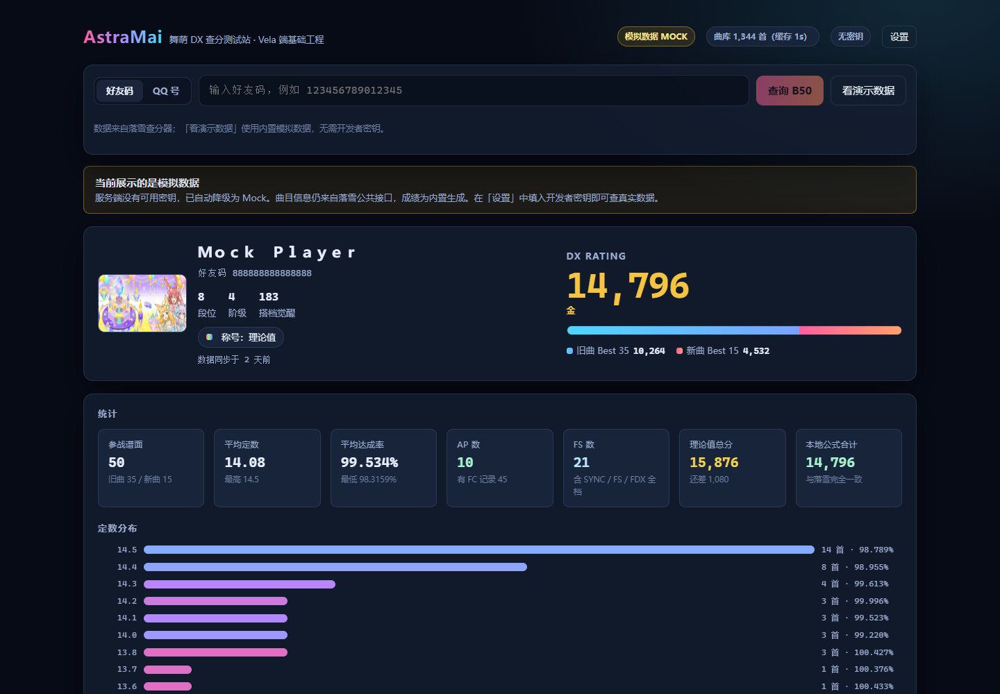
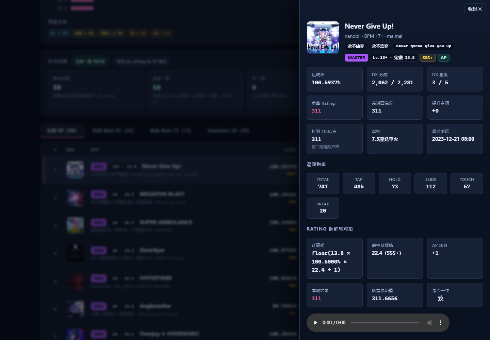
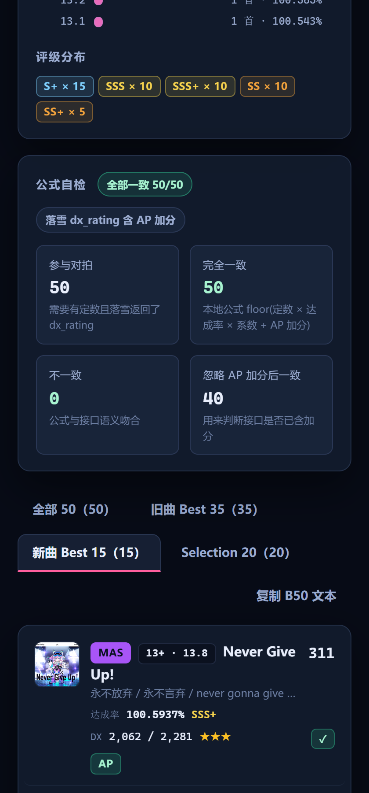

# AstraMai

面向**小米 Vela 端**的街机音游工具的基础工程，以及对接口的 **Web 测试站**。

当前已实现：**舞萌 DX 的 Best 50 查询**（玩家名片、B35/B15 构成、统计、逐条 Rating 公式对拍、单曲详情）。
后续规划：中二节奏（B30/New 20）、太鼓之达人、玩家二维码等功能，以及 Vela QuickApp 前端。

数据来源：[落雪查分器](https://maimai.lxns.net)（API 文档：<https://maimai.lxns.net/docs>）。

---

## 为什么要先写 Web 测试站

Vela QuickApp 的调试链路比浏览器长得多。把「接口对接 + 领域计算 + 交互」先在 Web 上跑通，
之后移植 Vela 时只需要换掉视图层，逻辑层可以整包搬过去——这也是本仓库分层的出发点。

```
packages/core   零依赖纯 TS：落雪 API 契约、DX Rating 计算、B50 组装、模拟数据
apps/server     Node 服务端：持有开发者密钥，对外只暴露聚合后的结果
apps/web        Vite + React：查分界面
```

**密钥永远不出现在浏览器里。** 浏览器只请求本机服务端的 `/api/*`，
由服务端带上 `Authorization` 头去访问落雪。

---

## 快速开始

要求 Node ≥ 20.10（开发时使用 22.14 验证）。

```bash
npm install

# 一次性构建核心层（web/server 依赖它的产物）
npm run build:core

# 开发模式：并行跑 core 增量编译 + 服务端 + 前端
npm run dev
```

打开 <http://127.0.0.1:5173>。

**没有开发者密钥也能用**：服务端会自动降级为 Mock 模式，
点页面上的「看演示数据」即可看到一份完整的 B50（曲库仍然来自落雪公共接口，成绩为内置生成）。

### 配置真实数据

复制 `.env.example` 为 `.env`（仓库里已经生成了一份空的），填入开发者密钥：

```dotenv
LXNS_API_KEY=你的开发者密钥
LXNS_MODE=auto
```

密钥在[落雪开发者面板](https://maimai.lxns.net/developer/apply)申请，
查 B50 需要 `allow_third_party_fetch_player` 与 `allow_third_party_fetch_scores` 两项权限。

也可以在页面右上角「设置」里临时填密钥（只存 sessionStorage，只发给本机服务端，不落盘）。
生产环境请把 `ALLOW_CLIENT_KEY` 设为 `false`。

### 生产模式（单进程同时提供接口和页面）

```bash
npm run build     # core → server → web
npm start         # http://127.0.0.1:8787
```

---

## 常用脚本

| 命令 | 作用 |
| --- | --- |
| `npm run dev` | 一键开发模式（core watch + 服务端 + 前端） |
| `npm run build` | 全量构建 |
| `npm start` | 以构建产物启动服务端（同时托管前端） |
| `npm run typecheck` | 全工作区类型检查 |
| `node scripts/smoke.mjs` | 对已启动的服务端跑端到端冒烟测试 |
| `npm run clean` | 清理 dist 与 workspace 的 node_modules |

---

## 接口一览

服务端只暴露三类接口，浏览器不需要也拿不到原始密钥。

| 方法 | 路径 | 说明 |
| --- | --- | --- |
| GET | `/api/health` | 运行模式、密钥状态、曲库缓存状态 |
| GET | `/api/maimai/b50/:friendCode` | **聚合接口**：一次返回可直接渲染的 B50 视图模型 |
| GET | `/api/maimai/b50/qq/:qq` | 同上，按 QQ 号查询 |
| GET | `/api/maimai/player/:friendCode` | 玩家信息（透传） |
| GET | `/api/maimai/player/:friendCode/song/:songId` | 单曲成绩 |
| GET | `/api/maimai/songs` | 裁剪后的曲库（`?notes=1` 带物量） |
| GET | `/api/maimai/aliases` | 曲目别名 |
| GET | `/api/maimai/search?q=` | 按曲名 / 艺术家 / 别名搜索 |

`/api/maimai/b50/...` 支持 `?mock=1` 强制走模拟数据。

---

## 关于 DX Rating 计算

`packages/core/src/maimai/rating.ts` 实现了官方计算式：

```
单曲 Rating = floor( 谱面定数 × min(达成率, 100.5%) × ランク係数 + AP加分(1) )
```

其中系数表包含「同档顶格」的特殊档位（例如 SSS 在 100.4999% 取 22.2，而 100.0000% 取 21.6），
这些是社区整理 + 官方说明里容易漏掉的细节。

因为这类细节写错了很难靠肉眼发现，本工程**不靠注释保证正确性**：

- 每次查询都会用本地公式对全部 50 条成绩重算，和落雪返回的 `dx_rating` 逐条比对；
- 页面的「公式自检」面板直接展示一致率、不一致样例，
  以及「落雪的 dx_rating 是否包含 AP 加分」这一结论（同时算含与不含两种结果，看哪个吻合）；
- `scripts/smoke.mjs` 把「自检必须 100% 通过」「官方总分必须等于本地合计」写成断言。

Mock 模式的数据也是按同一套公式生成的，所以自检在离线状态下同样会全部通过——
自检一旦变红，就说明公式实现被改坏了。

---

## 界面

B50 总览：玩家名片、B35/B15 构成、统计、定数分布、公式自检，以及逐条成绩列表。



单曲详情：物量、定数、Rating 拆解（含命中的系数档与 AP 加分）、与落雪的对拍结果。



窄屏（Vela 端尺寸参考）：列表改为卡片式堆叠，详情改为底部抽屉。



---

## 与 Vela 端的关系

`packages/core` 刻意做到：

- **零运行时依赖**；
- 不引用 Node 专有 API，`fetch` 通过结构化的 `FetchLike` 注入（QuickApp 的 `fetch` 直接可用）；
- 计算与格式化都是纯函数，输入输出可序列化。

`apps/server` 的 `/api/maimai/b50/...` 聚合成一个视图模型，也是为 Vela 准备的：
手表端带宽和算力都紧张，一次请求拿到全部渲染数据，比连发三次接口再在端上组装更合适。

---

## 目录结构

```
AstraMai/
├─ packages/core/src/
│  ├─ lxns/          API 类型、端点、客户端、错误与友好文案
│  ├─ maimai/        Rating 计算、B50 组装、常量、格式化
│  └─ mock/          确定性模拟数据（同一 seed 必得同一结果）
├─ apps/server/src/  配置、曲库缓存、路由、HTTP 工具
├─ apps/web/src/     React 界面与组件
└─ scripts/          dev / build / smoke / clean
```

---

## 已知边界

- B50 依赖落雪**已缓存**的数据；玩家若从未在落雪同步过，接口会返回 404。
- 落雪的 Selection 列表在部分账号上可能为空，界面会照常显示空分组。
- 宴会场（utage）曲目的 `level_index` 恒为 0，谱面定位靠难度标级二次匹配；匹配不到时会在「数据提示」里说明。
- 游戏资源（曲绘 / 音频）来自 `assets2.lxns.net`，官方文档提示有访问频率限制，请勿高频拉取。
