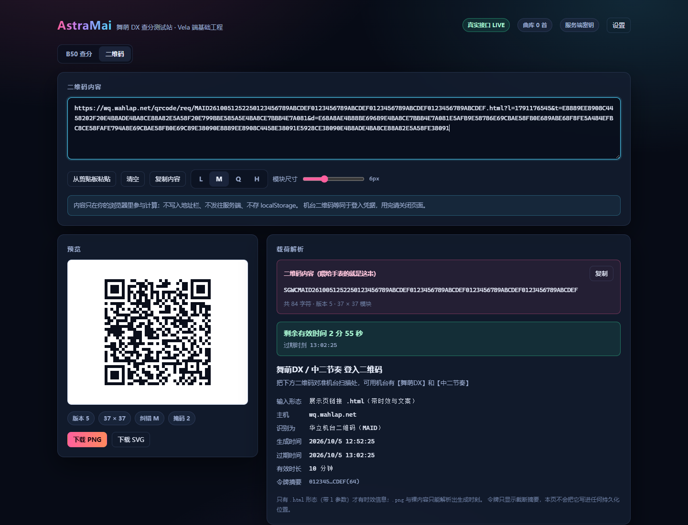

# AstraMai

面向**小米 Vela 端**的街机音游工具的基础工程，以及对接口的 **Web 测试站**。

当前已实现：

- **舞萌 DX Best 50 查询**——玩家名片、B35/B15 构成、统计、逐条 Rating 公式对拍、单曲详情
- **二维码工作台**——本地渲染机台二维码，含载荷解析与有效期倒计时
- **Vela QuickApp 骨架**——小米手表（eSIM）端，复用同一份 core，含 fetch 适配与三个页面

后续规划：中二节奏（B30/New 20）、太鼓之达人。

数据来源：[落雪查分器](https://maimai.lxns.net)（API 文档：<https://maimai.lxns.net/docs>）。

---

## 为什么要先写 Web 测试站

Vela QuickApp 的调试链路比浏览器长得多。把「接口对接 + 领域计算 + 交互」先在 Web 上跑通，
之后移植 Vela 时只需要换掉视图层，逻辑层可以整包搬过去——这也是本仓库分层的出发点。

```
packages/core   零依赖纯 TS：落雪 API 契约、DX Rating 计算、B50 组装、模拟数据
apps/server     Node 服务端：持有开发者密钥，对外只暴露聚合后的结果
apps/web        Vite + React：查分界面
```

**密钥永远不出现在浏览器里。** 浏览器只请求本机服务端的 `/api/*`，
由服务端带上 `Authorization` 头去访问落雪。

---

## 快速开始

要求 Node ≥ 20.10（开发时使用 22.14 验证）。

```bash
npm install

# 一次性构建核心层（web/server 依赖它的产物）
npm run build:core

# 开发模式：并行跑 core 增量编译 + 服务端 + 前端
npm run dev
```

打开 <http://127.0.0.1:5173>。

**没有开发者密钥也能用**：服务端会自动降级为 Mock 模式，
点页面上的「看演示数据」即可看到一份完整的 B50（曲库仍然来自落雪公共接口，成绩为内置生成）。

### 配置真实数据

复制 `.env.example` 为 `.env`（仓库里已经生成了一份空的），填入开发者密钥：

```dotenv
LXNS_API_KEY=你的开发者密钥
LXNS_MODE=auto
```

密钥在[落雪开发者面板](https://maimai.lxns.net/developer/apply)申请，
查 B50 需要 `allow_third_party_fetch_player` 与 `allow_third_party_fetch_scores` 两项权限。

也可以在页面右上角「设置」里临时填密钥（只存 sessionStorage，只发给本机服务端，不落盘）。
生产环境请把 `ALLOW_CLIENT_KEY` 设为 `false`。

### 生产模式（单进程同时提供接口和页面）

```bash
npm run build     # core → server → web
npm start         # http://127.0.0.1:8787
```

---

## 常用脚本

| 命令 | 作用 |
| --- | --- |
| `npm run dev` | 一键开发模式（core watch + 服务端 + 前端） |
| `npm run build` | 全量构建（含给 Vela 用的 core 单文件打包） |
| `npm test` | core 与 Vela 的全部测试（244 条 QR 黄金向量 + 13 项 fetch 适配） |
| `npm run bundle:core` | 单独重新打包 Vela 用的 core |
| `npm start` | 以构建产物启动服务端（同时托管前端） |
| `npm run typecheck` | 全工作区类型检查 |
| `node scripts/smoke.mjs` | 对已启动的服务端跑端到端冒烟测试 |
| `npm run clean` | 清理 dist 与 workspace 的 node_modules |

---

## 接口一览

服务端只暴露三类接口，浏览器不需要也拿不到原始密钥。

| 方法 | 路径 | 说明 |
| --- | --- | --- |
| GET | `/api/health` | 运行模式、密钥状态、曲库缓存状态 |
| GET | `/api/maimai/b50/:friendCode` | **聚合接口**：一次返回可直接渲染的 B50 视图模型 |
| GET | `/api/maimai/b50/qq/:qq` | 同上，按 QQ 号查询 |
| GET | `/api/maimai/player/:friendCode` | 玩家信息（透传） |
| GET | `/api/maimai/player/:friendCode/song/:songId` | 单曲成绩 |
| GET | `/api/maimai/songs` | 裁剪后的曲库（`?notes=1` 带物量） |
| GET | `/api/maimai/aliases` | 曲目别名 |
| GET | `/api/maimai/search?q=` | 按曲名 / 艺术家 / 别名搜索 |

`/api/maimai/b50/...` 支持 `?mock=1` 强制走模拟数据。

---

## 关于 DX Rating 计算

`packages/core/src/maimai/rating.ts` 实现了官方计算式：

```
单曲 Rating = floor( 谱面定数 × min(达成率, 100.5%) × ランク係数 + AP加分(1) )
```

其中系数表包含「同档顶格」的特殊档位（例如 SSS 在 100.4999% 取 22.2，而 100.0000% 取 21.6），
这些是社区整理 + 官方说明里容易漏掉的细节。

因为这类细节写错了很难靠肉眼发现，本工程**不靠注释保证正确性**：

- 每次查询都会用本地公式对全部 50 条成绩重算，和落雪返回的 `dx_rating` 逐条比对；
- 页面的「公式自检」面板直接展示一致率、不一致样例，
  以及「落雪的 dx_rating 是否包含 AP 加分」这一结论（同时算含与不含两种结果，看哪个吻合）；
- `scripts/smoke.mjs` 把「自检必须 100% 通过」「官方总分必须等于本地合计」写成断言。

Mock 模式的数据也是按同一套公式生成的，所以自检在离线状态下同样会全部通过——
自检一旦变红，就说明公式实现被改坏了。

### 真实数据下的验证结果

用真实开发者密钥拉取真实账号后：50 条成绩逐条一致，`standard_total` / `dx_total`
与本地算出的 B35 / B15 小计**完全相等**，差值为 0。

### 一个容易踩的坑：B35 / B15 不是按谱面类型分的

落雪 `/bests` 的 `standard`（35 条）与 `dx`（15 条）两个列表是按**曲子版本**划分的，
列表内部同时包含标准谱面与 DX 谱面。实测一份真实 B50 的 B35 里有 26 条是 `type: "dx"` 的成绩。

因此算 B35 / B15 小计必须按「来自哪个列表」拆，**不能**按 `score.type` 过滤——
按类型过滤会得到一份看起来很合理、但和官方总分对不上的小计。

---

## 界面

B50 总览：玩家名片、B35/B15 构成、统计、定数分布、公式自检，以及逐条成绩列表。


单曲详情：物量、定数、Rating 拆解（含命中的系数档与 AP 加分）、与落雪的对拍结果。


窄屏（Vela 端尺寸参考）：列表改为卡片式堆叠，详情改为底部抽屉。


二维码工作台：粘贴链接 → 本地出码 + 载荷解析 + 有效期倒计时。



---

## 二维码

### 三种形态，别搞混

机台二维码在链路上有三个不同的东西，**长度差 5 倍**，搞混会直接毁掉手表端的可用性：

| 形态 | 样子 | 长度 |
| --- | --- | --- |
| **二维码内容** | `SGWCMAID2401011200000123456789ABCDEF…` | **84 字符** |
| 展示页链接 | `https://wq.wahlap.net/qrcode/req/MAID….html?l=…&t=…&d=…` | ~400 字符 |
| 图片链接 | `https://wq.wahlap.net/qrcode/img/MAID….png?v=` | ~100 字符 |

三者共用同一个 `<MAID><12 位时间戳><32 字节令牌>` 标识，所以**从任意一种都能还原出二维码内容**。

机台真正读的是第一行那串 84 字符短码。拿第二行的链接去生成二维码虽然也能扫出东西，
但会得到一张 **77×77** 的码；正确内容只有 **37×37**（用字母数字模式则是官方的 33×33）。
在手表屏幕上，这个差别就是「扫得出来」和「扫不出来」。

`parseWahlapQrPayload()` 接受三种形态，并且**总是把 `content` 字段还原成那串短码**。

### 为什么要用这个还原而不是直接把链接喂给组件

这条路是**踩过坑才定下来的**：一开始以为二维码内容就是那个几百字符的展示页链接，
于是手表页直接把链接传给 `<qrcode value>`。后来把官方生成的 PNG 下载下来、
用独立解码器解了一遍，才发现里面只有 84 个字符：

```
SGWCMAID2401011200000123456789ABCDEF0123456789ABCDEF0123456789ABCDEF0123456789ABCDEF
└──┘└──┘└──────────┘└──────────────────────────────────────────────────────────┘
前缀  机型  12 位时间戳                     32 字节令牌
```

（上面是合成样本：时间戳取整点，令牌是重复的十六进制。）

官方那张 PNG 是 200×200、码区 198×198、**每模块 6px**（版本 4 / 字母数字模式）。
如果按错误的理解去做，手表上会显示一张模块只有 3.9px 的码——基本等于不可用。

顺带一提：**官方自己几乎没有留静区**（只有 1px，规范要求 4 个模块）。
我们这边渲染时留足 4 个模块，不要照抄。

### 为什么是「本地渲染」而不是「反代」

二维码内容是一张**登入凭据**：谁拿到都能在机台上登入这个账号。
`.html` 形态里的 `l` 参数是过期时刻，实测它比生成时刻晚 **10 分钟**。

这两点合起来决定了架构：

| | 服务端反代 | 本地渲染 |
| --- | --- | --- |
| 依赖 | 需要长期持有每个玩家的有效凭据 | 不需要任何凭据 |
| 手表离线出码 | 不行 | **可以**（短码是纯文本，本地生成） |
| 凭据泄露面 | 服务端一旦被拖库 = 批量账号失守 | **凭据不离开用户设备** |
| 维护成本 | 凭据 10 分钟一换，代理必须实时刷新 | 一次性 |

而且实测有效期只有 10 分钟——**这种时效的东西根本没法支撑一个代理服务**，
除非服务端为每个玩家维持一个长期在线、随时能重新签发的已登录会话，
那正是最难做也最危险的那件事。

> 本工程的 `parseWahlapQrPayload()` 只做**解析与展示**，不会去访问这些 URL 或其背后的服务。
> 界面上的令牌只显示截断摘要，内容不写 localStorage、不进地址栏、不发往服务端。

### 编码器的可信度是怎么建立的

QR 编码里全是「写错了也照样能渲染出方块」的环节（Reed–Solomon、BCH、掩码罚分），
肉眼根本看不出来。所以本工程用两层外部证据来锁：

1. **与成熟实现逐位对比**——写完就拿 `node-qrcode` 当参照，**486 组点阵逐位一致**，
   覆盖 4 个纠错等级 × 多种文本、8 个掩码逐一强制、以及版本 1–40 每个等级的满载边界。
2. **独立解码器往返**——用 `jsQR` 把生成的码再解回来，**43 组全部还原出原始字符串**。
   这证明的不只是「和另一个编码器一样」，而是「真的能扫」。

这两步跑完后，输出被固化成 `packages/core/test/qr-vectors.json`（244 条），
让 `npm test` 在没有第三方依赖的情况下也能守住回归。

### 踩到的坑：掩码罚分的口径分歧

差分测试一开始 486 组里错了 63 组，全部集中在**自动选掩码**，强制掩码则 128/128 全对——
说明数据编码没问题，是罚分规则有分歧：

- **规则 3**（疑似定位图形）有两种写法：给行/列两端补一段虚拟静区再做游程匹配，
  或直接匹配 11 位窗口 `10111010000` / `00001011101`。两者在贴边位置结果不同。
- **规则 4**（深色占比）我原来的写法在占比恰好 50% 时会算出 **-1**，是个真 bug。

现在统一采用 11 位窗口口径（主流实现 ZXing 与 node-qrcode 都用这个），
并在代码注释里写清了这个取舍——它**只影响 8 个掩码选哪个**，
任何一个掩码产出的都是合法可扫的码。

---

## 部署（放到公网给手表用）

手表访问的不能是 `127.0.0.1`。用 frp 把本机服务暴露出去是最省事的起步方案。

### 1. 先设访问令牌——这一步不能跳

**服务端持有你的落雪开发者密钥。** 没设令牌就挂到公网，等于把密钥和配额开放给
任何知道地址的人。

```dotenv
API_TOKEN=换成一串足够长的随机值
RATE_LIMIT_PER_MINUTE=120
```

设了之后，除 `/api/health` 外的所有接口都要求带令牌，且按来源 IP 限流。
客户端用 `Authorization`、`Bearer` 或 `X-API-Key` 任一种写法都认。

### 2. frpc 配置

关键点：**frpc 和本机服务在同一台机器上，所以 `localIP` 填 `127.0.0.1` 就行**，
不需要把服务改成 `HOST=0.0.0.0`。（之前我在 Vela 文档里写过要改 `0.0.0.0`，那是错的，
除非 frpc 跑在另一台机器上。）

```ini
# frpc.toml
serverAddr = "你的公网服务器"
serverPort = 7000
auth.token = "frp 自己的连接密钥"

[[proxies]]
name = "astramai"
type = "tcp"
localIP = "127.0.0.1"
localPort = 8787
remotePort = 8787
```

`frps` 那边同样配好 `auth.token`，并且**务必在防火墙/安全组里只放开必要的端口**。

### 3. 建议再加一层

frp 裸 TCP 是明文 HTTP。做成产品之前建议：

- 在 `frps` 前面套一层 Nginx/Caddy，挂域名和证书，让端上走 HTTPS
  （多数小程序/快应用平台对非 HTTPS 请求有额外限制，手表上也是同理）；
- 用 Nginx 再把 `API_TOKEN` 之外的路径也收一收，别把 `/api/echo` 之类顺手暴露了；
- 如果 frps 和 frpc 之间要跨不受控网络，给 frp 开 `transport.tls.enable = true`。

### 4. 手表侧配置

在应用的设置里填**公网地址**和**同一个 `API_TOKEN`**。
`apps/vela/src/common/api.js` 里的 `DEFAULT_SERVER_BASE` 只是个占位默认值。

---

## 与 Vela 端的关系

`packages/core` 刻意做到：

- **零运行时依赖**，且**不引用任何宿主专有 API**——连 `TextEncoder` 和
  `URLSearchParams` 都自己实现（后者不是 ECMAScript 的一部分，Vela 的引擎不保证有）；
- `fetch` 通过结构化的 `FetchLike` 注入，Vela 的 `@system.fetch` 接一个适配器即可；
- 计算与格式化都是纯函数，输入输出可序列化。

`apps/server` 的 `/api/maimai/b50/...` 聚合成一个视图模型，也是为 Vela 准备的：
手表端带宽和算力都紧张，一次请求拿到全部渲染数据，比连发三次接口再在端上组装更合适。

### 可移植性是验证过的，不是声称的

`scripts/bundle-core.mjs` 会把 core 打成一个零依赖单文件，
然后把它丢进一个**只有标准内建**的 JS 上下文里跑（没有 `Buffer`、`process`、`require`、
`fetch`、`TextEncoder`、`URL`、`URLSearchParams`、`document`）。
Node 里这些**全都有**，所以在 Node 上跑得通完全不能说明手表上跑得通——
这一步就是为了消掉那个盲区。当前 8 项检查全部通过。

详见 [apps/vela/README.md](apps/vela/README.md)，其中包括**尚未在真实工具链上验证**的清单
（`features` 名称、`router` 路径写法、`@system.storage` 签名、`designWidth`），
以及一个需要在真机上拍板的风险：**77×77 的二维码在手表屏幕上还扫得出来吗**。

---

## 目录结构

```
AstraMai/
├─ packages/core/src/
│  ├─ lxns/          API 类型、端点、客户端、错误与友好文案
│  ├─ maimai/        Rating 计算、B50 组装、常量、格式化、二维码载荷解析
│  ├─ qr/            QR 编码器（零依赖，Web 与 Vela 共用）
│  ├─ util/          UTF-8 / 十六进制编解码（不依赖 TextEncoder / Buffer）
│  └─ mock/          确定性模拟数据（同一 seed 必得同一结果）
├─ packages/core/test/  QR 黄金向量与回归测试
├─ apps/server/src/  配置、曲库缓存、路由、HTTP 工具
├─ apps/web/src/     React 界面与组件
├─ apps/vela/        Vela QuickApp（小米手表）：manifest、页面、fetch 适配与测试
└─ scripts/          dev / build / bundle-core / smoke / clean
```

---

## 已知边界

- B50 依赖落雪**已缓存**的数据；玩家若从未在落雪同步过，接口会返回 404。
- 落雪的 Selection 列表在部分账号上可能为空，界面会照常显示空分组。
- 「落雪的 `dx_rating` 是否含 AP 加分」这一结论需要 B50 里至少有一条 AP 成绩才能判定；
  账号没有 AP 时界面会显示「无法判定」，这属于正常情况（含与不含两种算法结果此时本就相同）。
- 宴会场（utage）曲目的 `level_index` 恒为 0，谱面定位靠难度标级二次匹配；匹配不到时会在「数据提示」里说明。
- 游戏资源（曲绘 / 音频）来自 `assets2.lxns.net`，官方文档提示有访问频率限制，请勿高频拉取。
